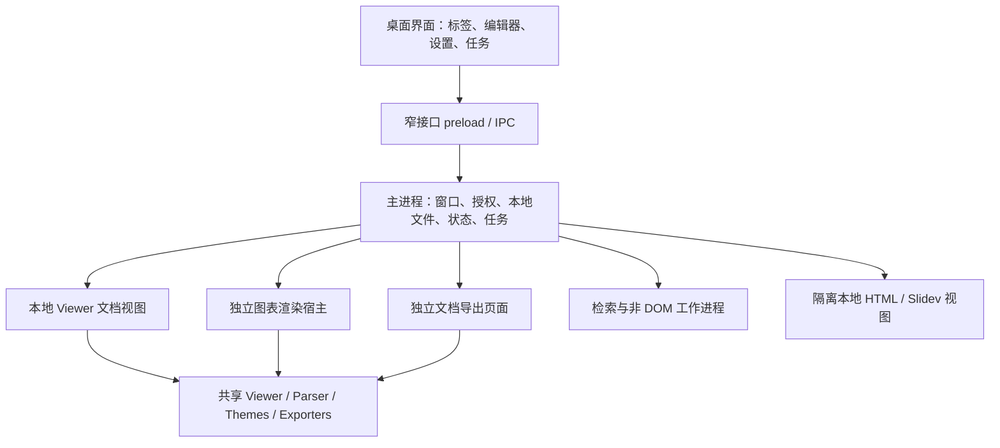

# Electron 本地桌面应用开发计划（个人使用版）

编制日期：2026-11-04。依据：当前仓库源码、功能注册表、现有测试及 [原型验证报告](VALIDATION.md)。

范围修订：按用户最新要求排除 Obsidian 链接与嵌入、笔记嵌入、CLI 自动化、原宿主互通、远程资源、在线 Markdown、整书导出、OpenAPI/Swagger、系统打印、EPUB 导出。本版替代此前的全产品功能并集计划。

本文是实施与验收依据，矩阵中的验收标准不表示功能已全部实现。用户已授权开发；截至 2026-11-05，已从前六个基础实施批次转入获批设计下的正式 Alpha 开发。最新状态见 [P6 交付检查](P6_DELIVERY.zh-CN.md)及 `test/feature-coverage.json`，各阶段仍按剩余验收项推进。

2026-11-05 顺序修订：按用户要求，**正式工程界面开发前先完成 D0 产品界面与交互设计并评审冻结**。用户已明确回复“设计评审通过”，[产品设计 V1.0](design/PRODUCT_DESIGN.zh-CN.md) 已冻结，批准及样稿哈希见 [评审记录](design/APPROVAL.zh-CN.md)。现切换 `feature/electron-desktop`，开始独立版本 `0.1.0-alpha.1` 的正式工程实现；前六批代码作为技术/功能资产复用。

2026-11-05 实施进度：正式开发已推进至 `0.1.0-alpha.2`，接入 CodeMirror 6、本地原子草稿暂存及异常退出恢复，见 [Alpha 2 记录](ALPHA_02.zh-CN.md)。完整功能矩阵仍未全部完成。

2026-11-05 后续进度：`0.1.0-alpha.3` 接入可取消的防抖实时预览、双向源码行定位及分栏滚动同步，见 [Alpha 3 记录](ALPHA_03.zh-CN.md)。表格/公式/图表内部按块近似定位，其他阶段仍以矩阵验收为准。

2026-11-05 后续进度：`0.1.0-alpha.4` 补齐同一数据目录的单实例、系统文件参数及原生文件/文件夹拖放入口，见 [Alpha 4 记录](ALPHA_04.zh-CN.md)。未命名草稿、完整导航与 SUMMARY 等 P2 验收项继续推进。

2026-11-05 后续进度：`0.1.0-alpha.5` 补齐未命名文档、新建入口、首次保存、编辑/阅读身份迁移与独立草稿恢复，见 [Alpha 5 记录](ALPHA_05.zh-CN.md)。导航前后退、SUMMARY 等 P2 剩余项继续推进。

2026-11-06 后续进度：`0.1.0-alpha.6` 接入会话内前进/后退、授权范围内的本地 Markdown 链接与锚点，以及 SUMMARY 嵌套目录阅读，见 [Alpha 6 记录](ALPHA_06.zh-CN.md)。完整书籍侧栏、编码恢复等仍按矩阵继续验收。

2026-11-06 后续进度：`0.1.0-alpha.7` 接入常驻章节侧栏、当前章节标记、前后章及 SUMMARY 草稿刷新，见 [Alpha 7 记录](ALPHA_07.zh-CN.md)。功能矩阵继续按剩余验收项推进。

2026-11-06 缺陷修复：`0.1.0-alpha.8` 修复宽表格溢出正文页面，超宽列在表格内部横向滚动，保留原有表格对齐；见 [修复及回归记录](TABLE_OVERFLOW_FIX.zh-CN.md)。

2026-11-06 再次修正：Alpha 8 的局部滚动未约束表格自身宽度。`0.1.0-alpha.9` 增加表格单元格长文本、URL/代码换行及密集列响应式适配，直接断言 table 与末列位于正文边界内，见 [表格自身适配记录](TABLE_WIDTH_FIT.zh-CN.md)。

2026-11-06 原文档复核：确认常用目录仍为 Alpha 7；Alpha 9 中目标表格已适配。`0.1.0-alpha.10` 进一步修复原文档窄分栏下表格外长代码撑宽阅读区的问题，新增原文档只读复核入口，见 [原文档宽度复核记录](REVIEW_DOCUMENT_WIDTH.zh-CN.md)。

2026-11-06 性能修复：`0.1.0-alpha.11` 用用户指定的大型接口文档定位并处理超大图表 GPU 上传、全量源码块位置扫描和滚动时全文比较开销，见 [滚动性能记录](SCROLL_PERFORMANCE.zh-CN.md)。

2026-11-06 阅读体验：`0.1.0-alpha.12` 改用中英文独立的系统无衬线阅读字体，提供手动字体、字号/行高、实际本机字体列表及效果预览，并接入原始 SVG/PNG 图表缩放预览，见 [阅读字体与图表放大记录](READING_FONTS_DIAGRAMS.zh-CN.md)。

2026-11-07 标签操作：`0.1.0-alpha.13` 增加标签右键菜单，支持关闭点击标签、关闭其他和关闭全部，批量统一确认未保存编辑稿并支持整体取消，见 [标签右键关闭记录](TAB_CONTEXT_MENU.zh-CN.md)。

2026-11-10 P2 编码恢复：普通打开识别 UTF-16 BOM，文件菜单提供“按编码打开”和“另存为 UTF-8”。保存保留原编码及换行，遇到原编码无法表示的字符时保留草稿并拒绝覆盖。已选编码随会话及最近记录恢复。详见 [macOS 构建和回归记录](BUILD.zh-CN.md#2026-11-10-本机构建记录)。

2026-11-11 P2 回归：Alpha 13 的 Windows x64 打包应用全量自动回归 131 个报告条目通过。详见 [Windows x64 回归记录](BUILD.zh-CN.md#2026-11-11-windows-x64-回归记录)。

2026-11-11 P3 共享设置：版本推进至 `0.1.0-alpha.14`，为共享 schema 的 12 项桌面设置提供控件，覆盖 34 个登记文档主题、Frontmatter、内容对齐、空单元格合并、首行缩进、Word 选项及侧栏布局。批量保存、预览刷新和设置重启恢复已接入。批注及其他 P3 验收项继续按矩阵推进，P2 人工目标机验收继续保留。

2026-11-11 P3 文档批注：版本推进至 `0.1.0-alpha.15`，接入选区标记、备注、批注侧栏、撤销、结构化复制及兼容批注文件。正文改动后可在侧栏确认新位置。批注按文档保存，支持重启恢复和未命名稿首次保存迁移。阅读布局、完整界面翻译和 Windows x64 新版本验证继续推进。

2026-11-11 P3 阅读布局：版本推进至 `0.1.0-alpha.16`，状态栏提供普通、宽栏、窄栏和正文缩放。布局、缩放和阅读位置按文档恢复，源码模式切换时保留阅读位置。原生全屏与专注阅读独立控制。完整界面翻译和 Windows x64 新版本验证继续推进。

2026-11-11 P3 界面语言推进至 `0.1.0-alpha.17`。桌面简体中文和英文覆盖菜单、设置、编辑器、批注、阅读控件及应用提供的原生对话框文案。语言可跟随系统或即时切换，重启后恢复。其余登记语言沿用可用的共享译文，桌面专用文案回退至英文。Alpha 17 的 Windows x64 打包应用全量自动回归 150/150 通过，用户确认回归手册中的人工检查均通过。详见 [Alpha 17 回归记录](BUILD.zh-CN.md#2026-11-11-alpha-17-界面语言)。

2026-11-11 P3 Markdown 阅读回归推进至 `0.1.0-alpha.18`。F05 新增打包应用专项，覆盖脚注导航、任务列表、数学公式、代码高亮、GitHub 警告块、Emoji、内联 HTML 和两种表格。详见 [Alpha 18 回归记录](BUILD.zh-CN.md#2026-11-11-alpha-18-markdown-阅读回归)。

2026-11-11 P3 缓存与设置回归推进至 `0.1.0-alpha.19`。修复清理期间旧图表任务写回缓存的问题，并补验所有登记语言的设置入口、清理缓存后的阅读状态，以及清空最近记录后的会话恢复。按本次安排跳过 Windows x64 复测。 [Alpha 19 回归记录](BUILD.zh-CN.md#2026-11-11-alpha-19-缓存与设置回归)

2026-11-11 P4 本地源码预览推进至 `0.1.0-alpha.20`。F12 接入普通文本、YAML 和代码文件的只读标签，支持本机打开、拖放、工作区和会话恢复。F12 的独立 HTML 和图片文件预览仍待实现。 [Alpha 20 回归记录](BUILD.zh-CN.md#2026-11-11-alpha-20-本地源码预览)

2026-11-11 P4 独立图片预览推进至 `0.1.0-alpha.21`。F12 接入本机图片的只读标签，支持缩放、平移、磁盘更新与会话恢复。独立 HTML 文件的隔离预览仍待实现。 [Alpha 21 回归记录](BUILD.zh-CN.md#2026-11-11-alpha-21-独立图片预览)

2026-11-11 P4 本地 HTML 预览推进至 `0.1.0-alpha.22`。F12 接入只读 HTML 标签，使用独立会话加载授权范围内的本地资源，阻断外部请求。F25 的 HTML 转 Markdown 另行推进。 [Alpha 22 回归记录](BUILD.zh-CN.md#2026-11-11-alpha-22-本地-html-预览)

2026-11-11 P4 HTML 转 Markdown 推进至 `0.1.0-alpha.23`。F25 支持从当前本地 HTML 和剪贴板提取正文并生成可恢复草稿；授权范围内的本地图片随草稿保存，草稿支持 Word 和 PDF 导出。P4 继续推进图表引擎和 Slidev 的打包离线验收。 [Alpha 23 回归记录](BUILD.zh-CN.md#2026-11-11-alpha-23-html-转-markdown)

2026-11-12 P4 独立图表推进至 `0.1.0-alpha.24`。F09 接入图表文件打开、源码切换、Word/PDF 导出及打包专项；Vega/Vega-Lite 可读取授权目录内的相对数据文件。P4 仍需接入 F10 Slidev 演示/列表、主题资源与静态导出。 [Alpha 24 回归记录](BUILD.zh-CN.md#2026-11-12-alpha-24-独立图表与离线回归)

2026-11-12 P4 Slidev 推进至 `0.1.0-alpha.25`。F10 接入演示、列表、翻页和全屏，随包提供九套主题和数学字体；本地图表和图片可离线渲染，支持按幻灯片分页的静态 PDF。P4 仍保留 F28 的额外本机资源目录授权和目标机验证。 [Alpha 25 回归记录](BUILD.zh-CN.md#2026-11-12-alpha-25-slidev-离线演示)

2026-11-12 P4 本机资源推进至 `0.1.0-alpha.26`。F28 接入按标签授权额外本机目录和撤销，覆盖 Markdown/Slidev 图片、HTML 图片与字体、Vega 数据和单文档导出。额外目录不进入工作区或持久授权。P4 本地格式可转入 P5 导出开发，Windows 目标机回归按用户安排暂缓。 [Alpha 26 回归记录](BUILD.zh-CN.md#2026-11-12-alpha-26-额外本机资源目录)

2026-11-12 P5 单文件 HTML 导出推进至 `0.1.0-alpha.27`。F17 接入隔离导出任务，内嵌样式、数学字体、本地图像和图表，在禁网会话打开移出的成品验证。P5 后续继续整页 PNG、当前文档资产导出和 Office 交互。 [Alpha 27 回归记录](BUILD.zh-CN.md#2026-11-12-alpha-27-单文件-html-导出)

2026-11-12 P5 整页 PNG 导出推进至 `0.1.0-alpha.28`。F23 的整页图像从独立窗口按文档快照生成，验证宽表格、文末图表和长文尾部；超限提示改用 PDF。F23 的当前文档图片与图表资产列表及按项导出仍待推进。 [Alpha 28 回归记录](BUILD.zh-CN.md#2026-11-12-alpha-28-整页-png-导出)

2026-11-12 P5 文档资产导出推进至 `0.1.0-alpha.29`。F23 增加图片和图表清单、类型/序号/源行筛选、格式选择、按项或批量导出，并保留失败行和导出报告。P5 后续推进图像与图表右键保存/复制及表格 Office 交互。 [Alpha 29 回归记录](BUILD.zh-CN.md#2026-11-12-alpha-29-文档资产导出)

2026-11-12 P5 图片和图表右键菜单推进至 `0.1.0-alpha.30`。F21 支持原格式另存普通图片、按原始分辨率保存或复制图表 PNG，以及按引擎能力保存原生 SVG 或 DrawIO。下一项是 F22 表格的 Office 剪贴板与 XLSX。 [Alpha 30 回归记录](BUILD.zh-CN.md#2026-11-12-alpha-30-图片和图表右键菜单)

2026-11-12 P5 表格复制与 XLSX 推进至 `0.1.0-alpha.31`。F22 增加表格右键菜单、HTML/TSV 剪贴板与保留合并区域及基本样式的 XLSX。macOS Excel 和 WPS 表格已验证打开和 HTML 粘贴；macOS Word 已验证打开代表性 DOCX。Windows 目标机仍待验收。详见 [Office 补验](BUILD.zh-CN.md#2026-11-12-alpha-31-office-补验)及 [P6 交付检查](P6_DELIVERY.zh-CN.md)。

2026-11-12 P6 已完成 macOS arm64 隔离配置的同版本恢复、Alpha 17 → Alpha 31 升级与备份回退演练（F32）。Windows x64 按用户安排暂缓。详见 [备份与回退记录](BUILD.zh-CN.md#2026-11-12-alpha-31-备份与回退)。

2026-11-12 P6 完成 macOS arm64 打包应用的 5 轮启动、Markdown 首屏与导出取消采样，记录了界面响应、导出窗口销毁和渲染进程退出。详见 [Alpha 31 性能基线](P6_DELIVERY.zh-CN.md#alpha-31-性能基线)。

2026-11-12 P6 推进至 `0.1.0-alpha.32`。10k 行/50 图表采样发现的标签阻塞和滚动回跳已修复；macOS 打包应用完成长文复测、50 次文档开关与 20 次导出的资源观察。下一项是 10,000 文件工作区的扫描、搜索和取消。详见 [长文和资源回收记录](P6_DELIVERY.zh-CN.md#长文渐进渲染与循环资源回收)。

2026-11-12 P6 推进至 `0.1.0-alpha.33`。工作区树支持分页，检索有实时进度并可扫描 10,000 个 Markdown。已验证两种检索的完整性、取消释放与单目录分页。详见 [10,000 文件工作区](P6_DELIVERY.zh-CN.md#10000-文件工作区)。下一项是核对保留功能和交付材料。

2026-11-12 P6 核对了 25 项保留能力、7 项完整排除和 2 项部分排除。范围测试发现桌面继承了 Wiki 语法改写，已在 `0.1.0-alpha.34` 关闭桌面阅读和导出中的该改写。详见 [功能覆盖核对](P6_COVERAGE_AUDIT.zh-CN.md)和 [Windows 源码同步与回归手册](WINDOWS_X64_REGRESSION.zh-CN.md)。保留功能的局部缺口和目标机验收仍待完成。

2026-11-12 P6 推进至 `0.1.0-alpha.35`。补上 F02 的「在工作区定位当前文件」与 F14 的阅读区代码复制；剩余明确实现缺口见 [覆盖核对](P6_COVERAGE_AUDIT.zh-CN.md) 的 F04、F19。

2026-11-12 P6 推进至 `0.1.0-alpha.36`。补上 F04 的最近工作区列表和按文档恢复阅读、分栏、源码模式。下一项为 F19 的 PDF 纸张、边距与分页预览；人工验收和目标机条件另见 [P6 交付检查](P6_DELIVERY.zh-CN.md)。

2026-11-12 P6 推进至 `0.1.0-alpha.37`。补上 F19 的 PDF 纸张、方向、边距与成品分页预览。已核对的功能缺口补齐，剩余真实文档、目标机和发布候选验收见 [P6 交付检查](P6_DELIVERY.zh-CN.md)。

2026-11-13 Alpha 37 macOS 打包应用完成 [10 份仓库材料试跑](P6_CANDIDATE_TRIAL.zh-CN.md)，10 份均打开成功，8 份计划导出均生成。第 10 节要求的用户真实文档由用户本机选择，另填[试用记录](P6_DOCUMENT_TRIAL.zh-CN.md)。

2026-11-13 Alpha 37 macOS 打包应用复测[备份与回退](P6_DELIVERY.zh-CN.md#alpha-37-实测结果)，同版本恢复和 Alpha 17 → Alpha 37 → Alpha 17 均通过；用户真实文档和 Windows 目标机验收仍待完成。

2026-11-13 按用户安排使用[10 份公开文档](P6_PUBLIC_DOCUMENT_TRIAL.zh-CN.md)替代准备私人文档。实测发现 Mermaid 渲染队列、时序图转换与 Slidev 封面等兼容问题；当前优先处理并复跑这些样本。

2026-11-13 Alpha 38 修复图表队列、Mermaid 时序图转图和 Slidev 本地背景；已[复跑受影响的公开样本](P6_PUBLIC_DOCUMENT_TRIAL.zh-CN.md#alpha-38-复测)。远程图片和依赖网络的图标仍不随离线导出加载。

2026-11-14 Alpha 39 为桌面 Mermaid 加入离线 Font Awesome 5 Free 图标，已[复测官方流程图样本](P6_PUBLIC_DOCUMENT_TRIAL.zh-CN.md#alpha-39-复测)。远程图片继续拦截；目标机条件见 [P6 交付检查](P6_DELIVERY.zh-CN.md)。

2026-11-14 按用户安排跳过 Windows 打包及实机验收，固定 Alpha 39 为 [macOS arm64 本地试用候选包](MACOS_ARM64_CANDIDATE.zh-CN.md)。原 Windows 正式交付条件保留为待办。

2026-11-17 至 18 按用户要求完成 Windows x64 本机打包和剪贴板修复复验。修订便携包全量回归 227/227，真实剪贴板专项、Office 粘贴及拼音组字检查通过；干净目标机断网等剩余项见 [Windows 本机验收记录](WINDOWS_X64_ACCEPTANCE.zh-CN.md)。

## 1. 目标、交付边界与个人使用约束

交付一个可独立运行的**本地文档桌面应用**，支持本计划保留的阅读、编辑、批注、图表、工作区和导出能力。日常使用无需安装 Chrome、Node.js、其他编辑器、Java、渲染服务或数据库。

交付默认按 Windows 10/11 x64 编制，具体最低系统版本须在 P0 对锁定 Electron 版本实测确认；保留 macOS/Linux 适配结构。其他操作系统首版验收是否纳入尚待用户选择。操作系统范围与功能完整性是两个维度，Windows 版也须完成全部功能矩阵。

功能范围以第 3 节保留矩阵为准：

1. 保留功能覆盖现有引擎的对应能力，不能仅限于原型已有的 Markdown、Mermaid、DOCX/PDF。
2. 所有入口位于桌面应用内；文件打开、分栏编辑、剪贴板和保存使用桌面能力。
3. 不开发浏览器/编辑器连接器、网页原位注入或 EXE 批量转换子命令。操作系统文件关联使用的路径参数仅用于打开界面内文档，不属于 CLI 转换自动化。
4. 仅使用本机文件与随应用打包的资源；本版不支持 HTTP/HTTPS 文档、图片、字体、数据源，以及 UNC/网络盘资源。
5. 本地 HTML 预览与本地/粘贴 HTML 转 Markdown 保留；普通 Markdown 本地链接、图片引用、目录导航保留。`SUMMARY.md` 的目录阅读保留，仅移除整书合并导出。
6. 系统打印被排除，**保存 PDF 仍保留**，内部继续使用 Chromium PDF 排版能力，不提供打印机选择或打印命令。
7. 此次仅调整桌面开发范围，不删除其他平台或共享核心已经存在的功能。新发现能力必须先检查是否属于排除项，再决定是否纳入。

个人使用的取舍：

- 本地单用户，无账号注册、订阅、计费、团队权限、云端同步、遥测或运维后台。
- 优先提供便携目录和 ZIP；需要文件关联时提供当前用户安装方式，无需管理员权限。
- 默认手动升级、可回退；首版不建设自动更新服务器，不以商店上架或购买代码签名证书为完成条件。
- 完成本计划保留的功能，优先复用当前引擎；减少新框架、常驻服务和数据存储组件。
- 应用运行时不联网；字体、图表库、Slidev 主题等所需资源全部随包提供。构建机器下载开发依赖不属于应用运行时功能。
- 保留许可证和第三方组件说明；个人交付不额外引入商业发布工程。

## 2. 原型历史基线：已证明什么、尚未证明什么

已证明：Windows x64 真实 Electron 窗口和打包 EXE 都能运行共享浏览器引擎；中文路径、相对 SVG、公式、表格、Mermaid、DOCX、PDF、受限文件访问可用；开发/打包测试均为 9/9 报告条目通过。实际 E2E 为 7 个子测试、1 个父测试，另有 1 个独立路径测试，不能解释为 9 个独立功能场景。

原型便携目录约 378.4 MiB；这是未优化包体的实测，不是完整版上限。文件对话框由测试桩返回路径，尚未验证人工点击系统对话框与干净机器部署。

原型阶段登记的替换项如下；已实施部分以各批次记录为准：

- 直接复用 CLI 的部分 `PlatformAPI`，平台仍标记为 `chrome`，不能作为桌面平台长期实现。
- Viewer、图表和导出工作共用前台页面，需要补齐大文档响应、单文档导出和渲染崩溃隔离。
- 单文件、只读、有限格式、固定设置，无持久化工作区、批注、主题界面或正式任务管理。
- 当前阻断外部请求的策略与修订后的本地范围一致，应保留；需要补齐所有本地图表、字体、Slidev 等打包资源。
- 全项目类型检查在未改动的三个 DOCX 模块及源码分发依赖中报错。现有 `docx: ^9.5.1` 本机解析为 9.15.2。必须在基础阶段修复或锁定兼容依赖，再建立回归基线。

原型测试保留为快速冒烟测试；所有完整版功能仍需分别实现和验收。

## 3. 功能覆盖矩阵

“验收”均指计划中的完成标准。`P0` 至 `P6` 见第 8 节。保留原功能 ID 以便追踪范围调整：保留 25 项，完整排除 7 项，部分保留项在各行明确界定。

### 3.1 明确排除项

| 原 ID / 能力 | 本版处理 |
|---|---|
| F11 OpenAPI/Swagger | 不集成 Redoc、API 文档判别或 `$ref` 解析；普通 YAML 可按文本/代码阅读 |
| F13 Obsidian 链接与笔记嵌入 | 不实现 wikilink、Vault 解析、Markdown/SVG 笔记嵌入展开；普通 Markdown 链接和本地图片仍支持 |
| F18 EPUB | 不提供 EPUB 导出、封装及阅读器验收 |
| F24 在线 Markdown/远程资源 | 不提供 URL 打开、远程图片/字体/数据源、代理、登录或网络缓存；不纳入网络盘/UNC |
| F26 网页原位渲染 | 不提供网页浏览器、在线网页代码块替换或嵌入 SDK 接入；本地 HTML 文件预览另见 F12 |
| F29 CLI 自动化 | 不提供转换子命令、脚本化批量接口、CLI 参数和退出码兼容 |
| F30 原宿主互通 | 不开发与浏览器、VS Code、Obsidian、移动宿主的发送/接收或未保存内容同步 |
| F19 的系统打印部分 | 只保留单文档 PDF 文件保存，不提供系统打印 |
| F20 的整书导出部分 | 保留本地 `SUMMARY.md` 目录阅读/章节切换；不合并章节输出 DOCX/PDF/其他整书文件 |

### 3.2 保留功能矩阵

| ID | 当前产品能力及源码证据 | 桌面实现与必须通过的验收 | 阶段 |
|---|---|---|---|
| F01 | 本地文件打开、原文保存；`formats.json`、Viewer 导出入口 | 打开文件/多选、拖放、文件关联打开、另存原文；支持中文/空格；取消与失败不破坏当前会话 | P2 |
| F02 | 工作区目录、文件树；`chrome/src/workspace/workspace.ts` | 打开文件夹、懒加载目录、定位当前文件、目录刷新；支持已有工作区文件类型及未知二进制提示 | P2 |
| F03 | 文件名/全文搜索、行定位、前进后退 | 可取消检索、结果片段/行号、跳转及历史；不因大目录扫描卡住界面 | P2 |
| F04 | 历史、阅读状态与自动刷新；Popup、FileStateService、file-change-tracker | 最近本地文件/工作区、滚动位置、布局和模式恢复；文件更新自动刷新并能暂停；历史条目可清理 | P2 |
| F05 | Markdown/GFM、数学、脚注、警告块等；`src/core/markdown-processor.ts` | 对现有 Markdown/编码夹具逐项对齐；含中英文、表格、任务列表、Emoji、HTML 表格、内联 HTML、代码、脚注 | P3 |
| F06 | 主题、字体、代码主题、版式；`src/themes/` | 覆盖所有登记主题/组合、字体与样式资源；首行缩进、表格/图片/图表对齐、合并空单元格、Frontmatter 等可配置并持久化 | P3 |
| F07 | 目录、缩放、布局、源码/阅读切换；Viewer Session、source-view | 普通/宽屏/窄栏、全屏、TOC、标题锚点、独立滚动与行号；源码模式下导出仍使用正确内容 | P3 |
| F08 | 编辑器侧预览与滚动同步；VS Code 宿主、line-based-scroll | 桌面内基础文本编辑、查找替换、撤销、保存、分栏预览、双向定位；外部编辑器修改可同步；保护未保存内容 | P2/P3 |
| F09 | Mermaid、PlantUML、Vega/Vega-Lite、DOT、Infographic、Canvas、drawio、ECharts；`formats.json`、`src/renderers/` | 每种引擎覆盖独立文件和 Markdown 代码块；SVG/HTML 内容按当前注册能力处理；测试正确、错误和资源引用输入 | P4 |
| F10 | Slidev；`src/slidev/`、`slidev-shell/` | `.slides.md`、现有主题、演示/列表模式、翻页、全屏、图表；打包全部 shell/chunk/theme 资源；验证实际导出路径 | P4 |
| F12 | 本地 HTML 文件预览与一般文本/代码/图片文件；workspace HTML sandbox | 保留隔离 HTML 预览、文本/代码高亮、图片显示和不支持类型提示；切换 HTML/Markdown/代码时状态正确；外部资源阻断 | P3/P4 |
| F14 | 图片/图表放大、拖拽、缩放、代码复制；`src/ui/diagram-lightbox.ts` 等 | 现有交互在桌面可用，Esc/键盘/高 DPI 正常，不把控制按钮导出到文件 | P3/P5 |
| F15 | 批注；`src/ui/remark-mode.ts`、remark-utils、Popup | 选择文本、四色、背景/下划线/波浪线/边框、备注、侧栏、悬浮提示、删除/撤销、配置、持久化、结构化复制、原格式导入/导出/合并、复制后关闭当前文档 | P3 |
| F16 | DOCX；`src/exporters/docx-*` | 保留可编辑 OMML、表格及合并、代码样式、图像、脚注、主题、分页/分隔线与 Emoji 设置；自动检查 OOXML，并人工用实际使用的 Word/WPS 打开 | P5 |
| F17 | 单文件 HTML；`src/exporters/html-exporter.ts` | 正确嵌入样式、图片、字体/公式所需资源；离线重新打开；无意外 CDN 依赖或源码面板/工具栏混入 | P5 |
| F19 | 单文档 PDF；print-utils、Chromium PDF 排版 | 保存 PDF 文件；纸张、边距、分页、长表、图表不裁切；独立 PDF 导出页面不改变前台阅读状态；无系统打印菜单 | P5 |
| F20 | GitBook/SUMMARY 目录阅读；gitbook-panel | 本地嵌套目录、章节切换、跨文档锚点/本地资源、标题条目；导出只针对当前文档，不合并整书 | P2/P3 |
| F21 | 图像/图表上下文菜单；image-context-menu、diagram-export-registry | 保存/复制 PNG；引擎有原生 SVG 或 DrawIO XML 时才显示对应导出；普通图片保持原有菜单语义；不把位图伪装为矢量图 | P5 |
| F22 | 表格复制与 XLSX；table-context-menu、table-xlsx | HTML+TSV 剪贴板矩形网格、真实 XLSX、真实合并区域与基本样式；在实际 Excel/WPS 粘贴、打开校验 | P5 |
| F23 | GUI 资产导出与文档 PNG；复用现有资产提取逻辑 | 界面提供整页 PNG、全部/按序号/按种类导出当前文档图片和图表；保留错误条目及源行；不提供 CLI 入口 | P5 |
| F25 | 本地/粘贴 HTML 转 Markdown；复用 Readability+Turndown | 提取本地 HTML 文件或粘贴 HTML 的正文/回退；本地基址正确，结果可保存和单文档导出；无 URL 读取，不下载远程图片 | P4 |
| F27 | 配置、语言、缓存、历史管理；SettingsService、settings-schema、Popup | 覆盖共享 schema 全部设置，另外审计不在 schema 内的批注/缓存/刷新配置；所有已登记 UI 语言可加载；缓存统计/上限/清理/失效正确 | P1/P3 |
| F28 | 本地资源、字体、编码恢复；DocumentService、encoding-recovery、resource-embedder | 本机盘符、长路径、BOM、当前编码恢复夹具、百分号、`#`、空格、中文、SVG/相对引用；可授权额外本机资源目录；不访问网络盘 | P1/P2/P4 |
| F31 | 开发与共享契约；`TESTING.md`、test/suites | 仅在公共核心被修改时执行受影响原平台回归；保留功能 → 桌面入口 → 自动测试 → 人工证据可追溯；不增加宿主互通功能 | P0/P6 |
| F32 | 桌面运行所需完整性（新增） | 标签页、窗口/会话恢复、菜单快捷键、单实例接收文件、系统主题、高 DPI、任务取消/错误恢复、个人数据备份与手动升级 | P1/P2/P6 |

### 3.3 覆盖规则

- `formats.json` 是现有图表文件/语言的清单来源，但并不包含所有 Markdown、HTML、YAML、图片和一般代码文件；必须同时核对 Viewer Session、workspace 的类型判别与测试。
- 导出限于当前文档和其中的资产：DOCX、PDF、单文件 HTML、整页 PNG，以及图片/图表 PNG/SVG/DrawIO 和表格 XLSX。P0 冻结适用组合；引擎没有的 SVG/DrawIO 能力禁用并说明。
- Slidev 按现有实际导出结果建立基线，不能声称所有交互均能进入静态文档。一个 `.slides.md` 文件内的多张幻灯片属于单文档范围，不属于整书合并导出。
- 普通本地 Markdown 链接与图片、SVG 文件、独立 Canvas 图表继续支持；不启用笔记嵌入展开。共享引擎如自动调用被排除功能，桌面装配需通过能力开关明确关闭，而不是只隐藏菜单。
- 远程引用在预览中显示受限/不可用提示；默认阻止把缺少关键资源的导出标为成功。用户可手动将资源下载到本地并修改引用，应用不代为联网获取。
- 现有源码中发现 AI SDK 依赖，但本轮未发现对应已实现的 AI 产品入口；不据依赖名称虚构 AI 聊天功能。P0 若从缺失文档或其他入口确认有现有业务功能，应补矩阵。
- `docs/` 和 `skills/` 当前为未提供内容的子模块。P0 应取得可访问文档或明确以代码与测试作为本次基线，并列出待核对项；当前计划不声称已经核对其全部内容。
- 后续维护 `desktop/test/feature-coverage.json`（计划新增），含功能 ID、来源、入口、测试、人工证据、状态；不能只维护一张全部标成“支持”的静态表。

## 4. 产品界面与日常工作流

本节为功能布局概述。正式界面的信息架构、视觉规范、响应规则、交互状态及评审条件以 [产品界面与交互设计](design/PRODUCT_DESIGN.zh-CN.md) 为待冻结基线；当前原型工具栏不能直接作为正式产品布局沿用。

主窗口：菜单/标签页 → 左侧工作区或搜索 → 中部编辑器/预览 → 可切换目录与批注侧栏 → 底部任务和诊断。界面默认中文随系统，可切换已有语言。避免在普通阅读界面展示 IPC、协议或缓存实现细节。

必须走通的用户流程：

1. 双击应用 → 拖入 Markdown 或文件夹 → 阅读/检索/批注 → 选择主题 → 导出。
2. 双击关联文件或拖入多个本地文件 → 由已有实例打开标签 → 下次启动恢复工作区和阅读位置。
3. 本地新建/编辑 Markdown → 分栏预览 → 保存；外部编辑器同时修改时提示冲突，不能静默覆盖。
4. 打开本地 `SUMMARY.md` → 目录导航/搜索 → 阅读章节 → 仅导出当前文档。
5. 打开图表独立文件或 Slidev → 使用相应阅读界面 → 根据能力表选择单文档导出。
6. 打开本地 HTML 或粘贴 HTML → 提取 Markdown → 保存本地或导出；不读取网址及外部资源。
7. 选中表格/图片 → 复制到实际使用的 Office 程序，或保存 XLSX/PNG/SVG/DrawIO。
8. 批注一个文档 → 重启仍可恢复 → 导出批注文件或结构化文字 → 在本应用中导入恢复。

## 5. 技术架构与模块分工

### 5.1 推荐结构



推荐保留 TypeScript、esbuild、现有原生 DOM 组件和 Slidev 的既有 Vue 构建；不整体改写 React/Vue 应用。基础编辑器拟采用 CodeMirror 6 的按需模块，不引入完整 VS Code 运行时。其模块化扩展方式见 [CodeMirror 官方指南](https://codemirror.net/docs/guide/)。具体版本在 P0 验证后精确锁定。

### 5.2 进程职责

| 模块 | 职责与限制 |
|---|---|
| 主进程 | 窗口/菜单/文件对话框、单实例、授权、IPC 校验、任务调度、状态落盘；不执行大规模 Markdown/图表转换 |
| Shell 渲染进程 | 标签、文件树、检索结果、编辑器、设置；只有明确的宿主 API，无任意文件系统和 shell 权限 |
| 文档视图 | 共享 Viewer、TOC、批注、源码模式、内容交互；文档内容与应用设置/菜单 DOM 分离，防止文档样式污染界面 |
| 图表宿主 | 独立隐藏 `BrowserWindow`/webContents，运行 DOM/Canvas/WASM 图表引擎；无通用文件或 Node 权限；有界队列、超时、终止重启 |
| 导出宿主 | 绑定指定文档版本和设置快照，准备独立 DOM，再执行 DOCX/HTML/PDF/图片输出；PDF 排版不改变前台阅读状态 |
| 检索/非 DOM 工作进程 | 使用 `utilityProcess` 或 worker threads 完成文件扫描、文本索引/哈希等；这是具备 Node 能力的受信程序，不拿它当不可信 HTML 沙箱 |
| 本地 HTML 视图 | 独立 session/partition、无应用 preload；本地活动内容在隔离视图内运行，仅按文档授权加载本机资源；外部请求阻断 |
| Slidev 视图 | 单独的本地 shell 及资源域；主题/图表走受控消息；仅为其真实需要配置 CSP，不放宽主界面策略 |

DOM/Canvas 图表不能直接搬进没有浏览器 DOM 的 `utilityProcess`。图表/导出窗口按需创建、复用并限制数量，避免每标签常驻一整套隐藏进程。

Electron 官方对嵌入页面提供 iframe 与 WebContentsView 等选择，并不推荐新项目使用 `<webview>` 标签。本计划在独立视图需要进程/会话控制时优先使用 WebContentsView；DOM 内嵌、来源固定的子视图才采用受限 iframe。参见 [Web Embeds](https://www.electronjs.org/docs/latest/tutorial/web-embeds)、[utilityProcess](https://www.electronjs.org/docs/latest/api/utility-process)。

### 5.3 平台适配和共享核心调整

1. 为 `PlatformType`、平台识别、构建宏增加 `desktop`；同时检查隐藏的 `=== 'chrome'`、`=== 'vscode'` 等分支。
2. 实现完整 DesktopPlatformAPI：cache、renderer、storage、file、fileState、resource、i18n、message、document、settings。
3. 新增 ElectronTransport，复用 ServiceChannel/RenderChannel 和已有请求信封；保留超时、取消、错误和块传输语义。
4. 引入能力声明（如 readLocalResource、savePdf、clipboardHtml、localHtmlConversion），让 UI 按能力显示，逐步替代平台名称判断；被排除能力在桌面明确关闭。
5. 从 Chrome 目录提取可复用的 TOC、toolbar、workspace UI 和 HTML 转换纯函数；避免桌面长期导入带副作用的 Chrome 入口，不新增原宿主连接器。
6. 将批注、剪贴板、下载、窗口关闭、配置监听中的直接 `chrome.*`/localStorage 依赖改为可注入宿主能力；不在桌面伪造完整 `chrome` 对象。
7. 设置默认值继续来自 `settings-schema.json`。批注、缓存等现有非 schema 配置先分类，再纳入对应 schema 或独立版本化配置；不直接塞进渲染默认值。
8. 格式、主题、语言、字体、stencil、WASM 与 Slidev 资源由清单构建；测试构建输出完整性，不手工复制一部分资源后宣称离线完整。

## 6. 关键数据与操作合同

### 6.1 文档身份和资源访问

- `DocumentId` 是稳定的内部身份，关联本机规范路径或未保存草稿；不可使用每次变化的资源 token 作为批注/阅读状态键。
- `DocumentVersion` 包含源内容哈希和必要的来源修订信息；编辑、外部修改、重新加载均产生新版本。
- `ResourceGrant` 记录用户选中的文件/工作区根、允许的额外资源根、会话/文档归属与有效期；先按规则解析相对路径，再做 canonical path 检查。
- 单独打开文件默认授权其目录；工作区模式授权工作区根，从而支持 `../images` 和普通跨文档链接。目录外本机资源可通过一次明确选择添加，不开放整个磁盘。
- 支持 URI 编码与文件系统路径的单次转换，覆盖本机盘符、大小写、长路径、`%`、`#`、中文、符号链接/junction 和不存在目标的父目录校验；UNC、网络映射盘不作为本版交付与验收要求，也不另建网络文件访问服务。
- 关闭文档、移除工作区或撤销授权会撤销相关 grant；文件搬移可重新定位并迁移阅读/批注关联。
- 应用资源、用户文档、隔离本地 HTML 分别使用不同资源域/session，不能使恶意文档请求主进程代码、其他文档或设置文件。

### 6.2 编辑与文件监控

- 支持未命名草稿、另存为、修改标识、撤销/重做、关闭前保存选择与异常恢复。
- 读取时保留/记录编码和换行信息，写入时尊重已支持格式，不能因预览而重写源文件。编码无法可靠判定时可选择编码重开。
- 保存采用同目录临时文件与可靠替换，保留失败恢复路径；覆盖前比较磁盘版本，处理外部编辑冲突。
- 文件监听覆盖本机源文件和已解析本地依赖；去抖、合并同一次保存事件，不递归监控所有磁盘。
- 渲染结果携带文档 ID/版本；仅最新版本可更新对应标签，切换文件与 HTML 初始化竞态使用现有回归场景验证。

### 6.3 任务、导出与消息

任务对象至少包含：`taskId`、`documentId`、`documentVersion`、`settingsSnapshot`、输入资源集合、阶段、进度、取消状态、结构化错误与产物信息。

- 预览、单文档导出、当前文档资产导出和检索分别排队；前台交互不等待导出任务完成。
- 默认重型导出串行；图表并发从低值开始，按测量调整。取消操作必须终止实际工作并回收临时产物。
- 用户导出期间继续编辑时，产物仍对应启动导出时的快照；界面显示该关系，不生成混合版本文档。
- 明确等待当前文档的图表、本地图片、字体和引用处理完成。失败包含文件/源行/引擎/原因；默认不把不完整输出标成成功。
- GUI 的“继续导出”必须附失败清单，不能悄悄吞掉异常；不开发脚本调用或退出码协议。
- 大二进制优先减少 base64 和多次复制，采用主机中转文件或受限分块协议；小 IPC 用结构化数据。MessagePort 的可转移对象按 Electron 实际接口验证，不承诺 ArrayBuffer 在每条跨主进程链路都零拷贝。
- 页面仅提交导出意图/受控任务结果，主进程根据系统选择的目的路径写文件；拒绝覆盖源文档、路径穿越和非法产物类型。

MessagePort 的接线与 IPC 限制参见 [Electron 官方说明](https://www.electronjs.org/docs/latest/tutorial/message-ports)。

### 6.4 本地个人数据

初版不引入数据库服务器。设置、历史和索引用小型版本化 JSON；批注按文档分文件；大缓存和导出临时文件独立目录。

```text
userData/
  settings.json
  workspaces.json
  sessions.json
  documents/<documentId>.json
  annotations/<documentId>.json
  drafts/
  cache/render/  cache/resources/
  backups/
  logs/
```

- 实际位置通过 `app.getPath('userData')` 获取；提供“打开数据目录”。便携包默认也使用用户数据目录，可显式选择便携数据模式，并检查是否可写。
- 文件包含 schemaVersion、可靠落盘与最近可恢复副本；升级前备份，失败恢复，未知新版本数据不能被旧版本破坏。
- 缓存键覆盖内容、引擎/插件版本、主题/字体、布局和本地资源修订；清理缓存不删除历史、批注和草稿。
- 设置和批注可导出/导入，沿用现有 remarks 数据格式减少重复实现；本版不读取其他应用 profile、不改造原扩展备份入口、不承诺跨宿主迁移。
- 日志默认不记录正文和完整资源授权地址；支持手动导出诊断。

### 6.5 离线与本地 HTML 边界

- 无联网模式、URL 输入、站点登录、代理或远程资源缓存；在所有内容/渲染会话中阻断外部请求。
- 应用所需图表库、WASM、字体、stencil 与 Slidev 主题随包提供；测试显式断网运行。
- 文档中的远程图片、CSS、字体、脚本和图表远程数据源不下载，提供本地化资源提示，不将被阻断误报为成功。
- 本地 HTML 可以在隔离视图内运行本地脚本，但不能访问应用 preload、其他文档或网络；仅通过受限资源服务读取已授权本机资源。
- 应用主界面禁止任意脚本/eval。若某现有引擎确需 WASM/eval，仅在对应受限渲染宿主中配置，并有专门回归用例；不关闭 webSecurity。
- 普通本地文档链接在应用打开；外部网站超链接可在用户点击后交给系统默认浏览器，此操作不导入内容、不授予应用联网资源能力。
- 本地 HTML 转 Markdown 不提取远程页面；无本地基址的粘贴 HTML 只处理所含内容和内联资源，未解析资源明确提示。

基本进程与 IPC 边界依据 [Electron 安全指南](https://www.electronjs.org/docs/latest/tutorial/security) 实施，与个人文档的本机文件访问直接相关。

## 7. 代码组织与构建交付

建议由当前 `desktop/` 渐进演进，不复制整个现有项目，不覆盖原型验证记录。

```text
desktop/
  src/main/       # app、窗口、菜单、本地文件、持久化、任务、协议
  src/preload/    # 各视图专用的窄接口
  src/platform/   # 完整 DesktopPlatformAPI 与 Transport
  src/renderer/  # 桌面 Shell、编辑器、工作区、设置
  src/render-host/
  src/export-host/
  src/contracts/ # IPC、文档、能力、任务类型与运行时校验
  test/unit/  test/contracts/  test/e2e/  test/fixtures/
  scripts/  resources/
  DEVELOPMENT_PLAN.zh-CN.md
```

实施要点：

- 主进程、preload、UI、图表宿主、导出宿主分别打包；各自 tsconfig；禁止把 Node 依赖打进不受信页面。
- 完整类型检查覆盖 `desktop/`；修复现有 Windows typecheck 包装器的进程启动/错误识别问题，不能返回“未实际检查却成功”。
- 使用精确版本和可追溯依赖锁定；当前 `.gitignore` 忽略 package-lock，P0 需为采用的锁文件明确例外并纳入版本控制，构建使用相应确定性安装方式。
- 仅打包运行时资产，排除 Playwright、PDF QA、TypeScript、测试夹具和开发 SDK；使用 ASAR，验证缺失资源和依赖许可证。
- 延续现有 packager 路线完成便携包，ZIP 用独立打包步骤；确需 per-user 安装器/文件关联时再接入单一安装工具，避免同时维护多套。
- 增加 `build:desktop`、`dev:desktop`、`test:desktop:unit`、`test:desktop:contracts`、`test:desktop:e2e`、`test:desktop:packaged`、`package:desktop` 和 `verify:desktop`。现有原型命令在迁移期保持可用。
- 每阶段保留一个可运行包、变更说明和验证记录。设计已冻结，正式开发分支为 `feature/electron-desktop`；独立版本、应用标识、数据兼容以 `desktop/app-manifest.json` 及实施记录为准。Git 提交按仓库规范执行，不能把未提交的工作区改动当成已有提交或原型 Git 快照。

## 8. 分阶段实施、依赖与工作量

人日以一名熟悉 TypeScript/Electron 的开发者、每天约 8 小时有效投入估算。阶段含本阶段开发和必要验证，P6 为跨功能集成与交付验收；不是所有功能开发完后才补测试。

| 阶段 | 主要工作与明确产物 | 退出条件 | 估算 |
|---|---|---|---|
| D0 产品设计与冻结（新增前置） | 产品结构、主流程、视觉 token、宽窄窗口、关键异常状态、可点击样稿、功能入口映射和评审记录 | 用户完成视觉/交互评审并确认设计基线；无未决内容安全流程；明确样稿和正式实现边界 | 依据评审轮次另估 |
| P0 范围与依赖基线 | 固定 25 项保留功能和排除项；冻结单文档/资产输入输出矩阵；处理 DOCX 类型错误；锁定依赖；确定 Windows 下限和测试机器 | 保留功能无未归类项；源码类型检查可执行且通过；vendor 问题可追踪；原型仍通过 | 3–4 人日 |
| P1 正式桌面基础 | TypeScript 入口、desktop 平台、Transport、本机资源合同、状态持久化、隔离 Viewer/图表/导出宿主、任务骨架、离线资源清单 | 无 CLI 假平台依赖；PlatformAPI 有实现和契约测试；本地授权正确；任务可超时/取消；外部请求阻断 | 5–7 人日 |
| P2 文件、工作区与编辑 | 多标签/单实例、文件选择/拖放、树、搜索、历史、编码、会话、监听、基础编辑/保存/冲突、本地 SUMMARY 目录 | 本地日常工作流可用；重启恢复；重复保存/切换/取消不丢数据；目录导航不触发合并导出 | 7–10 人日 |
| P3 阅读、设置与批注 | Viewer 装配、源码面板、TOC/布局/缩放、主题/语言、配置迁移、完整批注、缓存 UI | 保留的 Markdown/设置与夹具对齐；批注跨重启/导入导出；多标签状态不串扰；排除入口不出现 | 8–11 人日 |
| P4 本地格式与图表 | 全图表独立文件/代码块、Slidev 全资源、本地 HTML 隔离预览与转换、普通 YAML/代码阅读、失败诊断 | 每个保留引擎/格式有正反例、本地资源例和打包离线例；不引入 API 引用、笔记嵌入或联网依赖 | 6–9 人日 |
| P5 单文档导出与 Office 交互 | DOCX/HTML/PDF、整页 PNG、当前文档图片/图表资产、XLSX/剪贴板、进度/取消/快照 | 保留的输入输出矩阵通过；实际 Office 验证；无打印/EPUB/整书/CLI 入口；失败产物不误报成功 | 6–9 人日 |
| P6 交付与个人验收 | 保留矩阵回归、包体/性能、崩溃恢复、备份、升级回退、文件关联、便携 ZIP/可选安装器、真实本地文档试用 | 第 10 节全部达到；干净 Windows 机器通过；运行时无远程依赖；排除项无误启用 | 5–7 人日 |

原 P0–P6 基础估算合计 **40–57 人日**。计入依赖修复、Slidev/本地 HTML 隔离适配、复杂单文档导出与真实文档差异的约 20%–30% 预留，并取整后，原建议为 **50–75 人日（约 400–600 小时）**；一人全职约 **10–15 周**。该估算不包含新增 D0 及设计引起的已实现界面调整，不能继续作为修订后的总工期；D0 冻结后结合已有资产重估。以上均为规划估算，不是实测或交付承诺。

此前全产品并集计划的 62–92 人日基础估算、75–120 人日含预留估算已被本版替代。减少的工作主要来自 API/笔记嵌入、联网/网页集成、CLI/宿主互通、整书/EPUB/打印；完整桌面适配、编辑、批注、全部保留图表、单文档导出与目标机验证仍需实施。增加 macOS/Linux 首版交付须另估平台工作量。

后续依赖顺序：D0 设计冻结 → 正式工程切换/复核 P0/P1 → 补齐 P2/P3 → P4 → P5 → P6。已有代码与证据继续复用，涉及新界面装配的流程重新验证。每阶段均交付可运行包；最终完成以本版保留功能和全部阶段退出为准，不要求排除能力。

### 8.1 首个实施批次

先执行 P0 与 P1 的最小纵向链路：

1. 保存原型快照和测试证据，清点当前未提交改动。
2. 建立功能/输入输出矩阵与依赖锁定，修复既有类型检查问题。
3. 新增 `desktop` 身份、完整接口骨架和 ElectronTransport。
4. 完成本地文件资源授权与独立图表宿主，实现“打开 → 渲染 → 单文档导出”替代原型链路。
5. 将原型用例迁移到正式适配层，新增导出时继续编辑/切换文件与渲染宿主崩溃恢复用例。
6. 发布内部开发包和阶段记录，再扩展工作区、批注和本版保留格式；移除排除功能的桌面入口与运行时资源依赖。

## 9. 测试与质量计划

### 9.1 测试层次

| 层次 | 验证内容 | 运行时机 |
|---|---|---|
| 桌面单元测试 | 路径/授权、编码、配置迁移、版本/状态、任务状态机、缓存、保存冲突、搜索取消 | 每次涉及合同或纯逻辑的修改 |
| 公共契约测试 | 保留格式/schema 清单、主题/语言/字体、单文档/资产输入输出、DOCX/PDF/HTML/表格结构、渲染消息 | 每次更改共享核心/资源/适配 |
| Electron E2E | 真实窗口、工作区、编辑/批注、保留引擎、本地 HTML 转换、菜单/剪贴板、实际导出文件、外部请求阻断 | 相应功能阶段及合并前 |
| 打包 E2E | 实际 EXE、ASAR 资源、所有渲染器/字体/stencil/Slidev、保存路径、迁移恢复 | 每个阶段候选包 |
| 原平台回归 | 现有 Chrome E2E、VS Code/Obsidian 对应适配与公共核心测试；移动相关共享合同 | 共享模块被改动时 |
| 人工验收 | 系统对话框、文件关联、高 DPI、输入法、实际 Word/WPS/Excel 打开/粘贴、PDF 文件阅读 | P5/P6 |

遵守现有 `TESTING.md`：测试由 Node/Playwright 直接驱动，不依赖模型操作；E2E 使用本地夹具，保留原型的外部请求拒绝检查。不进行在线内容或登录验收；真实 Office 验收独立记录，不把自动测试桩当成人工系统集成验收。

现有 `fibjs` 单元层需要在开发/CI 环境补齐运行时；不为桌面另造所有共享测试，也不能因本机缺少 fibjs 直接跳过公共核心回归并报全通过。

### 9.2 代表性回归集合

- 文本：中英文、BOM/编码恢复、空文件、超长行、10k/50k 行、前后空行、CRLF/LF、HTML 表格、脚注、Frontmatter。
- 路径：中文/空格/百分号/井号、本机盘符、只读目录、文件删除/改名、junction、额外本地图片目录；不增加 UNC/网络映射盘兼容性验收。
- 渲染：每个保留引擎简单/复杂/错误/超时例；SVG/本地 HTML 脚本隔离；Slidev 多主题；远程数据/图片/字体不加载。
- 交互：快速 A→B→C 切换、搜索中切换目录、HTML/Markdown 来回切换、导出时编辑、批注后正文改动、打开相同文件两次、窗口关闭恢复。
- 导出：保留的单文档/资产格式、主题资源、长文/长表、多页 PDF、图表/字体异步、资源缺失、取消、磁盘满、目标被 Office 占用。
- 范围负例：API YAML 只作代码阅读；不启用笔记嵌入；无 URL 打开、系统打印、EPUB、整书导出、CLI 转换或宿主连接入口。
- 数据：首次启动、旧设置迁移、损坏 JSON、批注兼容导入、重复导入、缓存清理、异常退出恢复、升级后回退。

批注定位同时保留文本上下文/范围和版本信息；源文档变动后不确定的匹配标为待确认，不自动把备注贴到不相关段落。

### 9.3 性能目标（待 P0 固定基准机器，均非已测结果）

建议 Windows x64、16 GiB 内存、SSD，记录 CPU、分辨率、应用版本与冷/热缓存；每项固定夹具至少运行 5 次报告中位数和慢值。

- 冷启动到可操作目标 ≤5 秒；普通 1 MiB 以内纯文本 Markdown 到首屏目标 ≤2 秒。
- 10k 行/50 个图表文档优先首屏和渐进渲染；可滚动、可切换文件，不以“全部图表完成”阻塞操作。
- 长任务取消或切换文档的界面响应目标 ≤500ms；后端停止与资源回收另记录时间，不能只把按钮变成已取消。
- 工作区 10k 文件的扫描/搜索有进度与取消；先优化可用性，不预先引入大型索引数据库。
- 连续打开/关闭 50 个文档、重复 20 次代表性导出后，进程/窗口/文件监听器不持续增长；缓存回收后内存无持续线性上升。
- 内存绝对阈值和复杂单文档导出时限在 P1/P4 实测后确定；超过限额时排队、提示或降并发，不能让应用直接退出。
- 资源按需加载且离线资产完整；先报告包体构成再优化，不能以删除某个图表引擎换取“完整版包体达标”。

## 10. 完整版验收与交付清单

以下条件同时成立才算本次“本地个人桌面应用”完成：

1. 第 3.2 节的 25 项保留能力均有入口和证据；第 3.1 节排除项不作为交付要求，也不能在桌面无意启用。
2. 保留的单文档/资产输入输出矩阵全部适用单元格通过；PDF 保存保留，系统打印排除；目录阅读保留，整书合并输出排除。
3. 所有登记引擎、主题、语言及所需资源在实际安装/便携包中可用；断网不影响本地文档的完整核心流程。
4. 完整 DesktopPlatformAPI 替换 CLI 假平台；共享源码类型检查通过，vendor 未解决项有固定版本与明确处理，不允许无声忽略项目错误。
5. 桌面自动测试、打包测试和受影响原平台回归通过，且没有以缺依赖为由静默跳过。
6. 用户实际使用的 Word/WPS/Excel、PDF 阅读工具、系统对话框和文件关联人工验收完成；若某工具未安装，记录未验收并明确交付限制。
7. 至少一台未安装开发依赖/Chrome/Node 的目标 Windows 机器，断网完成本地打开、编辑、批注、保留格式代表导出、退出恢复与升级回退验证。
8. 用至少 10 份实际文档进行本地试用，可使用用户选择的本地文件或公开下载的文档。覆盖短篇参考、技术报告、图表密集文档、长文/长表、Slidev 演示和本地 HTML；不存在阻断日常使用的问题。
9. 个人数据可备份恢复，源文件无意外覆盖；异常/取消不会留下被标记为成功的不完整产物。
10. 提供 Windows 便携 ZIP、版本与构建信息、操作说明、快捷键、数据位置/备份/升级回退说明、功能覆盖和验证报告；文件关联有启用/移除方法。

每个阶段更新验证状态，不把“编译成功”“测试桩通过”“开发电脑可运行”混为目标环境验收。若目标系统范围扩展到 macOS/Linux，上述目标机器验收按平台分别执行。

## 11. 主要风险及处理顺序

| 风险 | 处理与检查点 |
|---|---|
| 原型覆盖窄、旧计划仍可能残留排除需求 | P0 固定 25 项保留能力与排除表；更新来源映射，只将范围内缺项补入登记 |
| 依赖漂移与现有类型错误 | P0 固定解析结果、修复兼容问题；建立确定性构建，避免无依据升级全部依赖 |
| Slidev/HTML/图表 CSP 或资源路径差异 | P1 先分离宿主；P4 每引擎打包离线测试；只放宽必要的隔离宿主 |
| 编辑、监听、预览、导出产生混合版本 | 文档版本、不可变导出快照、最新结果胜出、保存冲突检查与竞态 E2E |
| 大图表/长文占用过高导致应用退出 | 有界队列、独立宿主、超时取消和宿主重启，P4/P5 实测并设预算 |
| 批注/历史因 token、改名或正文变化丢失 | 稳定文档身份、迁移/重定位、批注上下文锚定与兼容文件格式 |
| 共享引擎隐式联网或启用被排除能力 | 构建剔除无关入口；桌面能力开关关闭；检测远程数据源；对所有视图阻断外部请求；断网打包测试 |
| 单文件和目录阅读被错误扩大为整书输出 | 明确导出绑定当前文档版本；SUMMARY 仅导航，不创建合并任务；验收无整书按钮 |
| 个人使用导致发布过度设计 | 手动升级、便携优先、无服务器；保持功能/数据恢复完整性，避免商店/证书工程成为关键路径 |

## 12. 本轮计划的证据索引

- 原型：[VALIDATION.md](VALIDATION.md)、`desktop/src/`、`desktop/test/`。
- 功能登记：`formats.json`、`settings-schema.json`、`src/themes/registry.json`、`src/_locales/registry.json`。
- 共享接口：`src/types/platform.ts`、`src/services/`、`src/messaging/`、`src/core/viewer/`。
- 完整阅读：`chrome/src/workspace/`、`chrome/src/webview/ui/toolbar.ts`、`src/ui/remark-mode.ts`。
- 转换/导出：`src/exporters/`、`src/ui/image-context-menu.ts`、`src/ui/table-context-menu.ts`；既有 CLI 中的资产提取实现只作 GUI 复用参考，不交付 CLI。
- 参考实现：`vscode/src/` 中的预览/滚动同步、`mobile/lib/` 中的本地状态服务、`chrome/src/webview/html-to-markdown.ts` 中的转换逻辑；不开发宿主接入。
- 验证规范：`TESTING.md`、`test/suites/extension-e2e/`、`export-contracts/`、`browser-contracts/`、`table-export/`、`plugin-rewrites/`。

这些本地证据用于界定保留能力的实现来源；排除清单优先于当前产品功能并集。Electron/编辑器技术选择引用各节官方资料。计划中的新模块、开发构建命令、测试与指标均需后续实施；开发用 npm 命令不属于被排除的用户 CLI 自动化功能。
